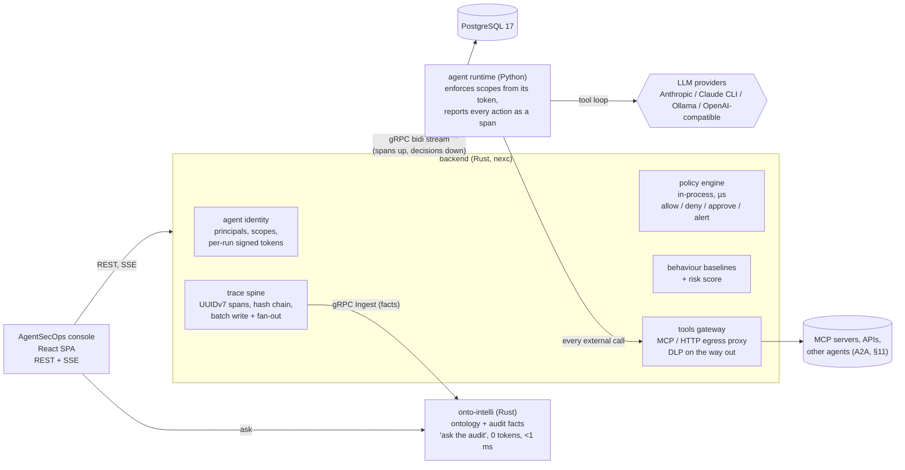

# AgentSecOps on nexc-engine: assessment and roadmap

<!-- #region preface -->
_Written 2026-10-17 against commit `ac41d1b` (branch `nexc-workspaces`)._

This document answers one question: what does nexc-engine need to become a platform that
**creates, configures, traces, defends and audits enterprise AI agents** at the level SoftBank
describes for its AgentSecOps PF (four functions: agent authentication and authorization,
defend, governance, observability), and what would we build first.

It is written to be shown to that team. Section 1 is an honest inventory, section 2 answers the
design questions raised, sections 3 to 8 are the proposal, section 9 is a five-minute demo script.

<!-- #endregion preface -->
---

<!-- #region assessment -->
## 1. Where nexc-engine stands today

nexc-engine is already a **node-execution engine for agents**: a graph of tasks is planned by an
LLM, scheduled as a DAG, and each node is executed by an LLM call, by a Paperclip-style agent born
in the Python runtime, or by texc-symphony. The parts that matter for AgentSecOps:

| AgentSecOps function               | What exists today                                                                                                                                                                                                                                                                                                                                             | What is missing                                                                                                                                                                                                                                                                                                        |
| ---------------------------------- | ------------------------------------------------------------------------------------------------------------------------------------------------------------------------------------------------------------------------------------------------------------------------------------------------------------------------------------------------------------- | ---------------------------------------------------------------------------------------------------------------------------------------------------------------------------------------------------------------------------------------------------------------------------------------------------------------------- |
| **Authentication / authorization** | Humans: Argon2, 15-minute JWT + rotating refresh with reuse detection, two-factor sign-in, session epochs that revoke tokens in seconds (`backend/src/security/`). Workspace roles and teams. Platform admins are isolated from workspace content. Backend to runtime: shared bearer token.                                                                   | **Agents have no identity.** An agent is a row (`name, role, model, system_prompt, reports_to, budget`) that runs under the user's credential. There is no per-agent principal, no scopes (which tools, which data, which counterpart agents, which hosts), no delegation limit except the hard-coded sub-agent depth. |
| **Defend**                         | Per-workspace guardrails: monthly token budgets, allowed providers, code execution switch, secret redaction before prompts (`backend/src/domain/guardrails.rs`). Sandboxed workspace per run, `python -I` with rlimits, untrusted context wrapped as data.                                                                                                    | No policy engine evaluated **per action**. No anomaly scoring. No quarantine of an agent. No DLP on what leaves (artifacts, external calls). No prompt-injection screen on tool results.                                                                                                                               |
| **Governance**                     | Workspace audit log of membership, teams, credentials, guardrails and knowledge changes (`backend/src/repo/audit.rs`). Platform activity log. Account security events. Issues, inbox and notifications exist.                                                                                                                                                 | Policies are one JSON blob per workspace, not versioned, not inherited (org → team → agent). No approval flow for agent actions. No data classification.                                                                                                                                                               |
| **Observability**                  | Prometheus metrics, `x-request-id`, JSON logs. Realtime events per node (`node.status`, `node.log`, `node.tokens`, `node.output`, `artifact.created`) over SSE, fanned out through PostgreSQL `LISTEN/NOTIFY`. `llm_usage` has one row per LLM call (workspace, user, graph, run, provider, model, cost). `node_runs` keeps status, attempts, tokens, output. | **No trace.** Tool calls, sub-agent spawns, data reads and policy decisions are not recorded as structured, linked events. `llm_usage` does not know the agent or node. Nothing is tamper-evident. Nothing answers "what did agent X touch this week?"                                                                 |
| **Providers**                      | Anthropic, the local Claude Code CLI, any OpenAI-compatible endpoint (Ollama, vLLM, LM Studio), offline demo. Keys encrypted with AES-256-GCM, passed per request, never stored by the runtime.                                                                                                                                                               | Model allow-list per agent (today per workspace only).                                                                                                                                                                                                                                                                 |

Two things the codebase already does right for this direction and should be kept:

- **UUIDv7 everywhere.** Every id is `Uuid::now_v7()` (69 call sites), so ids sort by time. The
  trace proposed below uses the same ids: a span id is a UUIDv7 and `run_id` is the trace id.
- **Everything is data, not code.** Node types, relation types and the ontology are per-graph
  data; guardrails are a per-workspace document. Agent capabilities and policies fit the same
  pattern.

Two things to correct in how we describe the product:

- "No authentication" is wrong. Human authentication is strong. What is missing is **agent**
  identity. That is exactly SoftBank's first function (the "employee ID card" for an agent), so it
  is the gap to lead with, not hide.
- The Python runtime (4.4k lines) is the only non-Rust service. It is where the Anthropic SDK,
  `python-docx` and the parsers live. The security design below treats it as **untrusted by
  construction**: every permission it has arrives in a signed token minted by the Rust backend,
  and every decision it makes is reported as a span the backend verifies. We do not need to
  rewrite it in Rust to get a Rust-enforced boundary.

---

## 2. Answers to the design questions

**Is nexc-engine the node-execution engine of an "enterprise execution" platform?**
Yes. The scheduler, the per-graph ontology, the agent org chart and the artifact pipeline are
the execution half. onto-intelli (`../onto-intelli`, Rust, gRPC, C ABI) is the intelligence half:
ontology, permission-filtered context, deterministic answers, audit with denials, governed action
types with risk and `confirm`. AgentSecOps is the layer that sits on both: identity, policy, trace.

**Can an "agentic wrapping" layer be added without authentication being there for agents?**
Yes, and there are exactly two seams to put it in, both already single chokepoints:

1. `backend/src/engine/executor/agent.rs` builds the runtime request. This is where the backend
   mints the agent's per-run token, filters the data the agent may see, and later records every
   span the runtime streams back.
2. `agent-runtime/src/nexc_runtime/tools/base.py`, `Tool.invoke`. Every tool call of every agent
   and sub-agent passes through this one method. This is where the scope check, the span and the
   DLP hook go. The LLM call in `agents/agent.py` is the second (and last) hook.

**Rust and C, gRPC not REST, millisecond latency: is that the right target?**
Partly. Be precise about what has to be fast:

- An LLM turn takes seconds. The security layer's budget is **less than a millisecond of overhead
  per action** so it is invisible. That means policy decisions are made **in-process at the
  enforcement point** from a signed token, never by a network round trip to a policy server.
- Trace ingestion must never block an agent: spans go into an in-memory channel, are fanned out to
  the realtime hub at once, and are batch-written to PostgreSQL. Target p99 under 1 ms from emit to
  fan-out, under 50 ms to durable and on screen.
- Audit queries ("which agents read customer documents today?") are graph queries, not LLM calls.
  onto-intelli answers deterministic questions in under 1 ms with 0 tokens; that is the right
  engine for "ask the audit".
- **gRPC** is right for machine-to-machine: backend ⇄ runtime (replace NDJSON-over-HTTP with a
  bidirectional stream carrying spans and decisions), backend ⇄ onto-intelli (it already serves
  gRPC, including client-streaming `EventService/Ingest`), and an external **Agent Firewall API**
  that other agent platforms can call (`Authorize`, `Report`, `Verify`). The browser keeps
  REST + SSE: a SPA cannot speak native gRPC, gRPC-Web adds a proxy for nothing, and the OpenAPI
  contract with generated types is a strength. "gRPC, no REST" should read "gRPC between
  services, REST only at the browser edge".
- **C** stays where it is useful: the hash chain of the trace (SHA-256 is already a C kernel in
  `backend/csrc/`) and MinHash similarity for behaviour baselines.

**Agents created by a human that act like real-world agents, configurable, no hallucination.**
Three concrete mechanisms, none of them magic:

- **Capability-typed agents.** An agent is created from a role template that carries tools, data
  scopes, model, budget and a policy. It is useful on first run because its knowledge bindings
  (knowledge topics, document labels, memory namespace, onto-intelli workspace) are part of the
  template, not something the user wires afterwards.
- **Evidence-bound answers.** Every fact an agent uses comes from a retrieval it can cite (document
  chunk id, memory id, onto-intelli entity id). A verifier rejects a final answer whose claims
  carry no citation, or marks them "unverified". This is the honest version of "no hallucination":
  grounded or refused, never silently invented. **Done, for every agent:** every piece of context
  a node is given carries a stable citation id (`[doc:<chunk id>]`, `[mem:<id>]`, `[node:<id>]`,
  `[fact:<id>]` reserved for ontology facts), listed on the node's `data_read` span; both prompt
  builders tell the model to cite the id after each claim and to end a statement of its own with
  `[assumption]`; when the node answers, the backend parses the citations out of the output and
  its Markdown artifacts (ids in code do not count), checks each against what was given (an id
  never given is forged), approximates the claims as the sentences, bullets and rows of the
  prose, and stores the coverage and the verdict (`verified`, `partial`, `unverified`) on the
  node run and as the node's own `policy` span named `evidence`, one per output (the built-in
  executor's one `llm_call` carries it too). The policy's `evidence` rule
  (`required`, `min_coverage`, `action: mark | reject`) decides what falls short means: a mark on
  the trace, or the node failed with the verdict as its reason. The run page, the node output,
  the agent card, the console and the trace explorer show the verdicts and the citations as chips
  that open what they point at; deliverables keep a Sources section; the demo providers cite what
  they were given, so `make demo-secops` shows it offline (§9, step 3). "Ask the audit" works
  the same way over onto-intelli's facts.
- **Dynamic configuration** is the existing pattern: capabilities and policies are JSON documents
  with versions and an audit entry per change, editable live, applied on the next run.

**Which LLMs?** Anthropic API, Claude Code CLI, Ollama and any OpenAI-compatible endpoint already
work per workspace and per user. Add a per-agent model allow-list and the policy engine refuses a
run that would use anything else.

---

## 3. Target architecture

Five rules the design follows:

1. **Every agent action is a span.** LLM call, tool call, sub-agent spawn, data read, external
   call, policy decision. Each span has a UUIDv7 id, a parent span, the agent principal, the
   decision that allowed it, start and end time in nanoseconds, and attributes.
2. **Decisions are made where the action happens**, from a token the backend signed. No network
   hop in the hot path. The backend re-checks on receipt and flags any disagreement as an incident.
3. **The trace is tamper-evident.** Each run's spans form a hash chain; the final hash is written to
   the workspace audit log and can be anchored externally. `GET /runs/{id}/trace/verify` recomputes
   it.
4. **The runtime is untrusted.** It can only do what its token says, and the backend builds the
   agent's context (documents, memories, upstream outputs) from the agent's scopes, so data the
   agent may not see never reaches the process.
5. **Policy is data with history.** Organisation → team → agent, each level narrows, never widens;
   every change is versioned and audited; a run records which policy version governed it.

<!-- #endregion assessment -->
---

## 4. Features, by AgentSecOps function

### 4.1 Identity: the agent ID card

<!-- #region identity -->
- **Agent principal.** `agents` gains `principal_id` (a stable URN such as
  `agent://{workspace}/{name}`), `owner_user_id`, `team_id`, `purpose` (one paragraph), and
  `capabilities` (JSON): allowed tools, data scopes (knowledge topics, document labels, memory
  namespaces, onto-intelli workspaces), allowed egress hosts, allowed counterpart agents, maximum
  delegation depth and fan-out, model allow-list, budgets. `status` gains `quarantined`.
- **Per-run token.** When a node is dispatched the backend mints a short-lived signed token
  carrying the agent principal, the human it acts for (`on_behalf_of`: who started the run and
  their workspace role), run id, node id, the capability snapshot and the policy version. The
  runtime refuses to start without it and checks every tool call against it. Sub-agents get a
  **narrowed** copy (never wider than the parent), held in the runtime's memory and never signed,
  which is how delegation is bounded.
- **Only the backend can sign.** The token is EdDSA (Ed25519), signed with a key the runtime
  never sees (`NEXC_AGENT_TOKEN_SIGNING_KEY`, or derived from the master key), named in the
  header by `kid` (its RFC 7638 thumbprint). The runtime and any outside verifier hold public
  keys only, configured or fetched from `GET /api/v1/agent-tokens/jwks.json`, which lists the
  signing key and the others still accepted, so keys rotate without a gap (CONTRACT §8). Until
  2026-10-20 the token was HS256 under a key derived from the runtime's own bearer secret: the
  runtime, which this design calls untrusted, could mint any token it liked. That key is gone,
  and setting `NEXC_AGENT_TOKEN_KEY` now stops both sides from starting.
- **Every principal's birth and death is on the record** (since 2026-10-20; older agents have no
  entry of their birth). Creating an agent (by hand, from a template, as a new workspace's default
  organisation, as an A2A counterpart's proxy) and deleting one are audited as `agent_created`
  and `agent_deleted`, in the same transaction as the change, with the actor; so are capability edits (`policy_changed`), quarantine and its release
  (`agent_quarantined`, `agent_released`).
- **Agent card.** The console shows what SoftBank calls the ID card: purpose, owner, team, scopes,
  model, budget left, last heartbeat, current risk score, policy version, and the agent's last
  twenty actions.
- **Done (§11):** each agent an admin exposes publishes an A2A agent card and takes A2A tasks
  through the firewall with the same principals; counterparts are external agent principals.

<!-- #endregion identity -->
### 4.2 Observability: the trace spine

<!-- #region trace -->
- **Span table** `agent_spans`: `id uuid (v7)`, `run_id`, `node_id`, `agent_id`, `principal`,
  `parent_id`, `kind` (`llm_call`, `tool_call`, `spawn`, `data_read`, `egress`, `policy`,
  `approval`), `name`, `started_at`, `ended_at`, `status`, `attributes jsonb` (tool name and
  argument digest, tokens, model, host, document ids read, bytes out, decision and rule id),
  `prev_hash`, `hash`. Indexed by `(run_id, id)` and `(agent_id, started_at desc)`.
- **Runtime emits spans** as new NDJSON lines today (`{"type":"span", ...}`, contract §8), and as
  gRPC messages once phase 4 lands. The backend's `handle_line` persists and fans them out as a
  `trace.span` SSE event, so the console shows them live.
- **Hash chain per run.** `hash = SHA256(prev_hash || canonical_json(span))` using the C kernel.
  The run's final hash is written to `audit_log` and shown on the run, and signed with a published
  key (§12). A verify endpoint recomputes the chain, checks the seal and reports the first broken
  link. Spans are append-only in the database, and deleting a graph keeps its runs' traces (§12).
- **Usage joins the trace.** `llm_usage` gains `agent_id`, `node_id`, `span_id`, so cost is
  attributable per agent, per tool, per policy.
- **Views.** Run trace waterfall (node → agent → turn → tool), agent activity timeline, workspace
  live feed, and "who touched what": documents, memories and hosts by agent.
- **Export.** OpenTelemetry OTLP export of spans is a thin mapping once the table exists; this
  closes the README roadmap item "OpenTelemetry tracing across backend and runtime".

<!-- #endregion trace -->
<!-- #region policy -->
### 4.3 Defend

- **Policy engine** (`backend/src/engine/policy.rs`): pure functions over (principal, action,
  context) → `Allow | Deny(reason) | RequireApproval(approvers) | Alert(severity)`. Rules are data:
  tool allow/deny, host allow/deny, data label clearance, token and cost ceilings, time windows,
  rate limits per agent (the token bucket in `dsa/` already exists), and "unusual behaviour above
  risk R". Compiled into the per-run token so the runtime evaluates the same rules locally.
- **Enforcement points:** `Tool.invoke` (tool calls), the LLM call (model allow-list, budget),
  `spawn_subagent` (depth, fan-out, counterpart allow-list), the backend context builder (data
  scopes), the tools gateway (egress hosts, DLP), artifact collection (DLP on files).
- **DLP.** Extend the existing secret scrubber with PII patterns and **data labels**: documents and
  knowledge topics carry a classification (`public`, `internal`, `confidential`, `restricted`);
  agents carry a clearance; the context builder drops what the agent may not see and the gateway
  blocks labelled content from leaving to a host not allowed for that label.
- **Prompt-injection screen.** Tool results and documents are already wrapped as data; add a cheap
  classifier pass (pattern + small model, configurable) that flags instructions inside data and
  records a `policy` span with the finding. Blocking is a policy choice, not a default.
- **Behaviour baseline and risk score.** Per agent, a rolling baseline from spans: tool calls per
  turn, tokens per turn, distinct tools, distinct hosts, spawns, denials, bytes out, outbound
  calls. Score = capped sum of z-scores, explained in words ("3× its usual egress, 2 new hosts").
  Thresholds → `Alert`, `Quarantine` (status flips, running nodes are cancelled, runs refused).
  MinHash over the tool sequence of a run gives "this run looks unlike anything this agent did
  before". External agents are scored the same way, and live while their runs are open (§13).
- **Kill switches.** Pause an agent, quarantine an agent, cancel a run, revoke a token (session
  epochs already do this for humans in seconds; the same gate works for agent principals).
- **The runtime's reach.** The backend's re-check only sees the spans the runtime reports, so a
  compromised runtime must not be able to act on its own. It reaches the backend's key set and its
  LLM endpoints, nothing else. In Kubernetes an Egress NetworkPolicy lets it reach the backend's
  second listener (`NEXC_KEYS_ADDR`, the key set alone, never the API) and `runtime-egress`, and
  no DNS, since a lookup of `<data>.attacker.example` is a way out; it finds both peers by their
  Service environment variables. In Docker Compose it sits on an internal network only, where
  Docker's DNS answers container names alone (there it can still reach the backend's API, as it
  always could). `runtime-egress` (`nexc egress-proxy`, from the backend image, with no secrets)
  opens a connection only to the `host:port` entries of `NEXC_RUNTIME_EGRESS_ALLOW` (Anthropic's
  API by default, a local provider by name), requires a tunnel to carry TLS whose server name is
  the host it was opened to (so a CDN that routes by name cannot be asked for another site),
  answers 403 to the rest and logs every connection. Tools that call out (`fetch_url`, MCP, A2A)
  were already the backend gateway's, under the policy.
- **Open gap: LLM traffic does not go through the gateway.** The runtime still talks to the model
  provider itself (through `runtime-egress`, which sees host names, never what is inside TLS).
  Nothing checks a prompt on its way out or counts its bytes against the policy, and a runtime
  that is compromised can send anything to an allowed provider, even under an API key of its own
  (an account its attacker reads): keep the allow-list to the endpoints in use. Closing it means
  routing model calls through the backend (which holds the keys anyway) or a gateway that
  terminates TLS; it is not done.

### 4.4 Governance

- **Policy as versioned data.** `policies` table: scope (`workspace | team | agent`), version,
  document, author, created_at, and an audit entry on every change. Each run records the
  resolved policy version. The console shows a diff between versions.
- **Inheritance that only narrows.** Resolution walks workspace → team → agent; a child may
  remove a tool, host or label, never add one.
- **Approval flow.** `RequireApproval` pauses the node (new status `waiting_approval`), creates an
  inbox item for the approvers (the notifications table and inbox page already exist), records an
  `approval` span with who decided and why, then resumes or fails the node. This also delivers the
  roadmap item "human-in-the-loop approval nodes".
- **Ownership and lifecycle.** Every agent has an owner and a team; orphaned agents (owner left)
  are paused automatically; agents report a heartbeat (already in the schema) and stale ones show
  in the console.
- **Compliance views.** "Which agents can read `restricted` data?", "which policies allow code
  execution?", "every denied action this month": all queries over the span and policy tables, and
  deterministic questions for onto-intelli.

<!-- #endregion policy -->
### 4.5 Ask the audit: onto-intelli as the central query service

<!-- #region audit -->
Spans and policy decisions are exported as ontology facts to onto-intelli over its gRPC
`EventService/Ingest` stream (or in-process through its Rust library, which removes the hop):
`agent —ran→ run`, `run —executed→ node`, `agent —used_tool→ tool`, `agent —read→ document`,
`agent —called→ host`, `agent —delegated_to→ agent`, `policy —denied→ action`. Then:

- "Which agents accessed customer documents this week?" is a deterministic graph query, 0 tokens,
  about a millisecond, permission-filtered by the asker's role.
- "Why was this run denied?" walks the cause chain the same way onto-intelli explains blockers.
- The LLM is used only to explain, with ranked facts it cites, which is the evidence-bound
  behaviour of section 2.

onto-intelli already has principals with role `agent`, restricted entities with ACLs, audit of
denials, and governed action types with `confirm` for high-risk actions. Those map directly onto
AgentSecOps governance for actions an agent takes **inside** the ontology (assign an issue, update
a record): nexc agents call them through onto-intelli's MCP server, under the same principal.

<!-- #endregion audit -->
<!-- #region templates -->
### 4.6 Creating agents that work on day one

- **Role templates** ship with capabilities, policy, knowledge bindings and an evaluation set of
  competency questions (onto-intelli's `eval` pattern). Creating an agent from a template runs the
  evaluation once and shows the score on the card.
- **Dynamic configuration** without redeploy: capabilities, policy, model and knowledge bindings
  are editable in the console; the next run picks them up; every edit is in the audit log.
- **Sub-agents inherit narrowed scopes**; the console shows the delegation tree per run.

### 4.7 Providers

No new work beyond the per-agent model allow-list. The CLI provider stays valuable for a demo
with no API key; Ollama for an air-gapped one.

<!-- #endregion templates -->
---

<!-- #region plan -->
## 5. Data model changes

| Table                                       | Change                                                                                                                                                                          |
| ------------------------------------------- | ------------------------------------------------------------------------------------------------------------------------------------------------------------------------------- |
| `agents`                                    | `principal_id text unique`, `owner_user_id`, `team_id`, `purpose text`, `capabilities jsonb`, `policy_version`, `risk_score real`, `quarantined_at`, status adds `quarantined`. |
| `agent_spans` (new)                         | as in 4.2, append-only, hash chained per run.                                                                                                                                   |
| `policies` (new)                            | `id`, `workspace_id`, `scope`, `scope_id`, `version`, `document jsonb`, `author_id`, `created_at`.                                                                              |
| `approvals` (new)                           | `span_id`, `run_id`, `node_id`, `requested_by principal`, `approver_ids`, `decided_by`, `decision`, `reason`, timestamps.                                                       |
| `llm_usage`                                 | `agent_id`, `node_id`, `span_id`.                                                                                                                                               |
| `node_runs`                                 | status adds `waiting_approval`; `policy_version`.                                                                                                                               |
| `documents`, `knowledge_topics`, `memories` | `label text` (classification).                                                                                                                                                  |
| `audit_log`                                 | actions add `policy_changed`, `agent_quarantined`, `agent_released`, `trace_sealed`, `agent_created`, `agent_deleted`.                                                          |

All ids UUIDv7. Nothing here is updated after write except `agents` and `node_runs`.

---

## 6. Protocol changes

1. **Contract §8 (now):** request gains `token` (the signed per-run agent token: EdDSA since
   2026-10-20, verified with the backend's public keys) and `capabilities`; stream gains
   `{"type":"span", ...}` lines. Backwards compatible.
2. **gRPC between backend and runtime (phase 4):** one bidirectional stream per run,
   `Execute(stream RuntimeEvent) returns (stream BackendCommand)`. Spans, deltas, tokens and
   artifacts go up; `cancel`, `approval_granted`, `policy_update` come down. Rust side with
   `tonic`, Python side with `grpclib`. The NDJSON path stays as a fallback for one release.
3. **gRPC Agent Firewall API (phase 4):** `AuthorizeAction`, `AwaitApproval`, `ReportSpan`
   (client-streaming), `VerifyTrace`, `GetAgentCard`. Any external agent platform, or a sidecar
   in front of one, can use nexc as its policy and trace service. Same principals, same
   policies, same risk scores and approvals (§13).
4. **onto-intelli:** `EventService/Ingest` for facts; `IntelliService/Ask` for the audit box.

---

## 7. Performance targets and how we prove them

`make prove` already runs the worst-case suite; add a `prove-agentsecops` target with these
assertions, measured on the demo provider so numbers are stable:

| Measure                                                  | Target                     |
| -------------------------------------------------------- | -------------------------- |
| Policy decision, in-process (runtime and backend)        | p99 < 100 µs               |
| Span emit → realtime fan-out                             | p99 < 1 ms                 |
| Span emit → durable in PostgreSQL (batched)              | p99 < 50 ms                |
| Span emit → visible in the console over SSE              | p99 < 100 ms on a LAN      |
| Deterministic audit question via onto-intelli            | p99 < 5 ms, 0 tokens       |
| Trace verification, 10,000-span run                      | < 50 ms (C SHA-256 kernel) |
| Overhead added to a 12-turn agent run with 40 tool calls | < 0.5 % of wall time       |
| Live risk, one firewall span folded and scored           | p99 < 50 µs                |
| Exfiltrating external run, first anomalous span → stopped | < 1 s                      |

Every number is printed by the test and pasted into the README's compliance table, the way the
project already documents its worst cases.

---

## 8. Phased plan

Rough effort for one engineer with Claude Code; each phase is shippable and demo-able on its own.

| Phase                      | Weeks   | Delivers                                                                                                                                        | Demo moment                                                                                                                                                     |
| -------------------------- | ------- | ----------------------------------------------------------------------------------------------------------------------------------------------- | --------------------------------------------------------------------------------------------------------------------------------------------------------------- |
| **0. Trace spine**         | 1–2     | `agent_spans`, span lines from the runtime, hash chain, `trace.span` SSE, run waterfall and agent timeline, verify endpoint, `llm_usage` joins. | Watch a run's tool calls appear live; break one row in the database; verification points at it.                                                                 |
| **1. Identity and scopes** | 2       | Principals, capabilities, per-run signed tokens, narrowed sub-agent tokens, scope-filtered context builder, agent card.                         | Give the Researcher no access to `confidential` documents; it provably never sees them, and the span says why.                                                  |
| **2. Policy and Defend**   | 2–3     | Policy engine, versioned policies with inheritance, approval flow through the inbox, DLP labels, risk score, quarantine, kill switches.         | An agent tries a tool it is not allowed; denied in 60 µs; a `restricted` document never leaves; an unusual run trips an alert; one click quarantines the agent. |
| **3. Ask the audit**       | 1–2     | Fact export to onto-intelli, the "ask" box in the console, evidence-bound answers with citations.                                               | "Which agents read customer data today?" answered in a millisecond with the entity ids.                                                                         |
| **4. gRPC and gateway**    | 2–3     | Bidirectional gRPC backend ⇄ runtime, tools gateway with MCP servers per workspace and egress policy, Agent Firewall API, OTLP export.          | An external agent asks nexc "may I call this host?" over gRPC and gets a signed decision and a span id.                                                         |
| **5. Console polish**      | ongoing | Agent registry, live feed, policy editor with diff, approvals, trace explorer, risk dashboard.                                                  | The single screen a CISO wants to see.                                                                                                                          |

Phases 0 to 2 are the core; after them nexc-engine covers all four AgentSecOps functions end to
end. Phase 3 is the differentiator (an ontology-backed audit nobody else demos). Phase 4 is what
makes it a platform other agents can sit behind, which is what SoftBank's Agent Firewall is.

<!-- #endregion plan -->
---

## 9. Five-minute demo

<!-- #region demo -->
1. **Create an agent** from the "Analyst" template: purpose, owner, scopes (knowledge topic
   `finance`, label clearance `internal`, tools `read_file write_file make_docx`, model
   allow-list), budget. The card shows its evaluation score.
2. **Run a graph** with it. The trace waterfall fills in live: turns, tool calls, a sub-agent with
   narrowed scopes, tokens and cost per span.
3. **Evidence.** Attach a document the Analyst may read; the research node's output cites
   its passages by id (chips on the run page open them) and is verified. Relabel the document
   `restricted` and run the same node again: it is withheld, the coverage drops to zero and
   the template's policy marks the output (a `policy` span named `evidence`); set the policy's
   `evidence.action` to `reject` and the node fails with the verdict as its reason.
4. **Policy in action.** Edit the policy to require approval for `make_docx`; re-run; the node
   waits, the approval lands in the inbox, approve it, the run continues; the approval is a span.
5. **Defend.** Attach a `restricted` document to the goal; the agent's context never contains it
   and the span records the drop. Then make the agent call a disallowed host: the demo script
   starts an HTTP stub on the machine and tells the research node to read the figures from it;
   the agent's `fetch_url` goes up the gRPC stream to the backend's tools gateway, which
   performs it while the allow-list names the host (an `egress` span with the host, the HTTP
   status and the bytes; the stub sees `nexc-engine-gateway/…`, not the runtime) and refuses it
   once the host is off the list, before any connection: a `policy` span with the rule, an
   alert, the risk score rises, quarantine with one click, running node cancelled. On the
   NDJSON wire the runtime is offered no gateway tool, so the script falls back to a tool the
   policy does not allow and says so.
6. **Ask the audit.** "Which agents read restricted data this week?" "Why was run 0199… denied?"
   Both answered from onto-intelli in a millisecond with ids, then "explain" with the model, every
   sentence cited.
7. **Prove it.** `make prove-agentsecops` prints the latency table; `GET /runs/{id}/trace/verify`
   shows the chain intact, then flags the row we tampered with.

<!-- #endregion demo -->
---

<!-- #region not -->
## 10. What this proposal deliberately does not do

- **No rewrite of the runtime in Rust now.** Security does not depend on the Python process
  being honest; it depends on the token and on the backend's re-check. A Rust runtime (texc-symphony
  is the precedent) can come later for performance, not for security.
- **No gRPC to the browser.** REST + SSE stay at the edge; gRPC is service-to-service.
- **No central policy server in the hot path.** Decisions are local and signed; the central
  service is for authoring policies and querying the trace.
- **No "zero hallucination" claim.** The claim is "evidence-bound or refused", and the verifier
  that enforces it is part of the product.
- **No A2A/ACP in the first release.** The gateway and principals are designed so these protocols
  are adapters added later, as SoftBank's Agent Firewall does. (A2A came after the roadmap as
  exactly such an adapter: §11.)

<!-- #endregion not -->
---

## 11. A2A on the firewall

<!-- #region a2a -->
The Agent-to-Agent protocol is an adapter on the parts above, not a second security model.
`docs/CONTRACT.md` §10 has the wire; this is where it sits.

- **A counterpart is a principal.** A workspace registers a remote A2A agent by its card URL
  (Settings → A2A counterparts). The registration makes an external agent of the workspace,
  `agent://{workspace}/a2a:<name>`, and issues it an API token exactly as the Agent Firewall API
  issues one: that token is what the remote agent presents, so every inbound call is from a
  principal nexc knows, with a status it can quarantine and a token it can revoke. The host of
  the card is checked as the gateway checks any egress host at registration.
- **An inbound task is a run.** An admin exposes an agent (`a2a_exposed`, audited). A task sent
  to its JSON-RPC endpoint becomes a one-node run of that agent in a managed graph of its own,
  executed by the instance that took it, so everything the roadmap built applies unchanged: the
  per-run token, the context builder's data scopes, the gateway for the agent's own calls, DLP
  on its artifacts, the risk baseline, approvals, alerts. The run's chain opens with the inbound
  call as a `tool_call` span marked `inbound` (the caller's principal, the task id, a digest of
  the message) and the firewall's decision as a `policy` span: the counterpart list of the
  agent's capabilities and its delegation depth decide it, as they decide a sub-agent's birth.
- **An outbound task is an egress.** A counterpart is offered to agents as the gateway tool
  `a2a:<name>` under the policy, and the gateway performs it like `fetch_url` or an MCP tool:
  the counterpart's own allow-list of agents, the capabilities' counterpart list and depth, the
  host under the egress rules (private hosts only when named), the data labels against the
  counterpart's clearance, the DLP screen of the message; then the task, streamed when the
  remote card says so, within the A2A timeout and the gateway's size cap. The answer's files
  are artifacts of the node, screened like any other; the call is a `tool_call` and an `egress`
  span naming the remote task.
- **Depth and loops cross platforms.** A task carries `nexc.hop` and `nexc.chain` in its A2A
  metadata; every outbound call made while answering an inbound task carries one more hop and
  the chain with the agent appended. The agent's resolved `delegation.max_depth` bounds the
  hop wherever the hops happened, and a chain that already names the agent, or a callback to a
  counterpart already in it, is refused as `delegation.loop`: each refusal a `policy` span, the
  run failed before the agent starts, the task answered `failed` with the rule.
- **What the console shows.** The agent card's A2A tab (the switch, the card's addresses, the
  tasks received with who called, the hop and the refusal), Settings → A2A counterparts, and
  the trace explorer's `inbound` kind. The metric `nexc_a2a_tasks_total{direction, outcome}`
  counts tasks either way.

In SoftBank's terms: the agent card is the ID card shown outward, the counterpart's token is
the visitor's badge, the firewall decides at the door, and the trace keeps the visit on record.

<!-- #endregion a2a -->
---

## 12. Evidence that survives

<!-- #region evidence -->
_Added 2026-10-20 after a review of the trust layer against SoftBank's public AgentSecOps
material._ The trace spine (§4.2) made every run a hash chain, but four things let that evidence
be lost or doubted: deleting a graph cascaded through its runs to every span, payload and seal, and
nothing recorded it; nothing in the database stopped a span or an audit entry from being changed or
removed; the audit log itself was not chained; and the firewall's signing key had no id, no rotation
and no published home, while run seals were not signed at all. This section is what closed them.

**Deleting a graph archives it.** `DELETE /graphs/{gid}` sets `graphs.deleted_at` and `deleted_by`
instead of removing the row. The graph leaves every list and every graph endpoint (the
`graph_access!` predicate every reader goes through skips it), its queued runs are cancelled and its
running ones asked to stop (a run that changes hands afterwards ends cancelled), its issues stop
pointing at it, and onto-intelli's map drops it and its runs. Its runs, their spans, their signed
seals, their payloads' metadata and their artifacts stay, and the run, its trace and its
verification, its sessions, its artifacts and its payloads, its evidence bundle and
`GET /graphs/{gid}/runs` still answer for whoever could open the graph. A `graph_deleted` entry
names who deleted it. Removing an agent archives its managed graph the same way (the agent row is
locked first, so a managed graph created meanwhile cannot be cascaded away). We weighed three ways
to keep the evidence:

- *Refuse the delete while sealed runs inside retention exist.* Spans have no retention of their
  own (only recorded payloads do), so a graph that ever ran could never be deleted, and a person who
  wants a graph gone would learn about evidence retention from a 409.
- *Detach the runs* (`runs.graph_id` set to null). Every reader of a run assumes its graph; more
  than a hundred call sites would change, and the node rows the spans name would go with the graph,
  so a kept trace would point at nodes nobody can read.
- *Archive the graph* (chosen). Nothing the evidence refers to moves: the graph row, its nodes and
  its runs stay as they were, so a trace reads and verifies exactly as before, and access stays what
  it was (whoever could open the graph). The cost is one predicate: every reader of graphs skips
  archived ones, and the evidence endpoints use `graph_access_any!`, which does not. A team keeps
  its archived graphs until they are purged, so it cannot be deleted before then.

**The retention purge is the way evidence leaves.** The housekeeping worker removes recorded
payloads once they are older than the workspace's `recording.retention_days` (as before, now a day
at a time, so the log gets one entry a day) and, under the same setting but never sooner than 30
days, an archived graph once it was deleted and its runs last ended or stirred that long ago, with
its runs, spans, payloads and artifacts. Each removal writes `evidence_purged` to the workspace's
audit log in the transaction that deletes. Shortening the retention is itself on the log
(`guardrails_changed`), so a short retention followed by a deletion leaves three chained entries
behind it. Two other paths remove evidence, both by erasing everything around it: erasing a whole
workspace (its owner, a platform administrator, or the erasure of its only member's account),
recorded in the platform log as `workspace_deleted` with the runs, spans and audit entries erased
and the audit chain's last hash, written in the transaction that erases it since the workspace's
own log goes with it; and an erased account's graphs from before workspaces existed.

**Append-only in the database.** Triggers refuse any `UPDATE`, `DELETE` or `TRUNCATE` of
`agent_spans` and `audit_log`, and any change to a sealed run's `trace_hash` and seal (SQLSTATE
42501), so a bug or a statement that did not opt in cannot rewrite evidence. The purge paths run in
a transaction that first names itself:
`SELECT set_config('nexc.evidence_purge', pg_current_xact_id()::text, true)`; a value left on a
role, a database or a connection string matches no transaction and opens nothing. The one change an
audit entry allows is the erasure of an account's name (`nexc.evidence_redact`): the name becomes
`Deleted account`, its salt goes and nothing chained moves. A transaction setting was chosen over a
dedicated database role because a role needs `CREATEROLE` at migration time, which managed databases
often withhold. Neither stops the tables' owner, who can drop a trigger (the tests do, and watch
verification catch the edit).

**The audit log is a hash chain per workspace.** The database chains every entry as it is written, in
a `BEFORE INSERT` trigger under a lock on the workspace's chain head (`audit_chain_heads`), so no
writer can skip it and concurrent writers cannot fork it:
`hash = SHA-256("nexc-audit-v1" || prev_hash || workspace_id || seq || id || created_at || actor_id ||
actor_digest || action || subject_digest || detail)`, with the byte layout in `docs/CONTRACT.md` §4.
Names enter as salted digests (`SHA-256(salt || name)`), so erasing an account takes its name out of
the log without breaking the chain, and a known name can no longer be tested against the digest.
`GET /workspaces/{wid}/audit/verify` recomputes the chain in Rust from the first entry to the head
recorded when the check began: it names the first changed entry, counts the erased ones, and shows a
removed tail, because the chain then ends short of its head; a head lost to a partial restore is
taken up again from the last entry. A workspace transfer copies the log in chain order, so the
target computes the same hashes, and refuses to finish when it does not: a chain changed or cut on
the source cannot arrive whole. What the chain cannot show is a rewrite by someone who recomputes
every later hash and the head as well: the database's owner can. Against that, only what left the
database before helps: evidence bundles already exported, and the anchoring sketched below.

**Seals are signed, and keys have ids.** When a run ends, the backend signs the canonical statement
`{"kid", "run_id", "sealed_at", "spans", "trace_hash", "type": "nexc.run_seal.v1"}` with its Ed25519
key and keeps the statement, the signature and the key id on the run (`runs.seal_*`); the
`trace_sealed` entry names the key. The key id is the RFC 7638 thumbprint of the public key, so an id
cannot name another key. `GET /.well-known/jwks.json` publishes the current key and the retired ones
(`NEXC_SIGNING_KEYS_RETIRED`), each under its id. Firewall decisions carry the `kid` too, in the reply
and inside the signed bytes. A new install gets a key of its own (`nexc init`, `scripts/init-env.sh`);
an existing one keeps the key it had, derived from `NEXC_MASTER_KEY`, and production warns about that
at start. To rotate: read the current public key from the key set, set a new `NEXC_SIGNING_KEY`, and
add the old public key to `NEXC_SIGNING_KEYS_RETIRED`; what the old key signed still verifies by its
id. Restart every replica at once (until they all run the new key, the old ones do not know its id).
At start the backend warns about seals signed by a key it no longer publishes, and refuses to start
when a retired entry is a private seed of a key that signed (it would be published). Keep the key
with the backups: a restore on a new host with a new key leaves every seal unverifiable unless the
old public key is retired there. After a workspace transfer, add the source's public key to the
target's retired keys. A retired key keeps verifying what it signed; if one leaks, take it out of the
set, and what it signed has to be exported again under the current key.

**Evidence bundles verify offline.** `GET /runs/{rid}/evidence` (workspace owners and admins who
could open the graph, archived graphs included) exports every span in chain order, the signed seal,
the payloads' metadata, the workspace's audit entries about the run and its graph as chained (past
10,000, the seal's, the deletion's and the newest), and an attestation: the backend's signature over
a manifest of each audit entry's hash and digest (names and salt included), how many entries were
about the run, the chain's last hash, the seal's signature and a digest of the run and payload
metadata. The export is an `evidence_exported` entry, written first, so the bundle carries its own
export. `trace_sealed` is written in the transaction that seals the run, so every sealed run has it.
`nexc-verify <bundle> --keys jwks.json` (or `make verify-bundle BUNDLE=… KEYS=…`; the backend image
ships it) checks it with the public keys alone, no database and no network: the chain recomputes from
genesis to the sealed hash, the seal is signed by a published key and seals this chain, every audit
entry hashes as stored and adjacent ones link, `trace_sealed` records this seal and the key the log
says signed it (a stripped seal fails), a deleted graph's bundle carries its `graph_deleted` entry,
and the attestation covers everything else. A span, seal or audit entry changed in a bundle, or one
removed from it, fails it. A bundle shows what the database held when it was exported; it cannot
show what was rewritten before.

**Upgrading.** Migration `20261020000201` chains the existing audit log in one pass under a lock
on `audit_log` (about 2.5 s per 100,000 entries on a laptop); for a large log, run `nexc migrate` before
rolling the new version out. Replicas of the previous version fail on the new triggers when they
delete a graph, an agent or a workspace, or erase an account: roll this release out with the
`Recreate` strategy, or one replica at a time with those actions held. Going back means restoring
the database from before the migration.

**Design notes, not built.**

- *External timestamps (RFC 3161).* Today the time of a seal is the backend's own word. A timestamp
  authority's token over each seal statement (or over a daily Merkle root of seals and audit chain
  heads, to keep requests few) would let a third party vouch that the evidence existed then, which
  also bounds what a stolen signing key could backdate. The token would sit beside the seal
  (`runs.seal_tst`) and travel in the bundle; `nexc-verify` would check it against the authority's
  certificate. Open questions: which TSA, offline fallback, and the cost of one request per run.
- *WORM export.* The database owner can still drop the triggers. Shipping each sealed run's bundle
  and each day's audit chain head to object storage under a retention lock (S3 Object Lock in
  compliance mode, or the equivalent) puts a copy beyond the operator's reach for the retention
  period. The export worker would mirror the OTLP exporter (a cursor, batches, a status on
  `/admin/infrastructure`); verification would compare the stored heads with the live chain.

<!-- #endregion evidence -->

---

## 13. The firewall scored and held

<!-- #region firewall-risk -->
On 2026-10-20 a comparison with SoftBank's public AgentSecOps material and a skeptic's read of the
code found the main Agent Firewall scenario weaker than the native one: an agent nexc does not
host got signed decisions and a verifiable trace, but its runs were never scored (no baseline, no
anomaly alert, no anomaly quarantine), `require_approval` led nowhere, and a run that went rogue
part way through was stopped only by per-action rules. Each now works as it does for a native
agent, and the firewall adds what an agent running elsewhere needs: a score taken while the run
is still going.

- **Scored when it closes.** Every run of an external agent is scored when it is sealed, by the
  same code as a native run's (`engine/risk.rs`): its baseline, its alerts, its quarantine. A
  reported run is compared with the agent's reported runs; a decisions session (the run its
  `AuthorizeAction` calls go to when they name none) with its earlier sessions, a separate
  baseline (`agent_session_baselines`), since a window of decisions is not a run. Sessions are
  15-minute windows, so they compare like with like. The decisions themselves count: an allowed
  egress is an outbound call to that host, an allowed tool call is that tool, a denial a denial,
  so an agent that reports nothing but asks before acting has a baseline too. A reported call to
  a host the policy denies is a mismatch, as a refused tool is.
- **Scored while it runs.** Each span and each decision is folded into the run's counts as it
  arrives (`firewall/live.rs`), and the counts that only grow are scored against the baseline:
  outbound calls, hosts, bytes out, denials, tools, sub-agents. Because they only grow, a partial
  run never scores above what the same spans score at the end, so the live score stops only runs
  the end-of-run score would have flagged, earlier. It waits for a baseline of five runs, since a
  young baseline whose features never varied scores any change at full cap. When it reaches the
  policy's `quarantine_risk_score`, the agent is quarantined (the same alerts and audit entry,
  marked mid-run), the decision that crossed it and every later one are refused, a reported run's
  stream is answered at once and takes no more spans, and the trace ends with a `live_risk` span:
  the score, the reasons, the span that tripped it, the first anomalous span and the time from it
  to the run stopped. The containment runs on a task of its own, so an agent that hangs up the
  moment it crosses is quarantined all the same. A run that crosses the threshold, live or at its
  end, is not learned: a run that went rogue is not what the agent usually does.
- **Held for a human.** A decision that requires an approval is an approval of the approvals
  engine, in the approvers' inbox and the alert destinations like a native one. The agent awaits
  it with `AwaitApproval` (a poll, or a wait of up to a minute, on any instance); the decision it
  finally gets is signed like any other, names the approval and the arguments' digest, and is the
  `approval` span on the agent's run. A reported call of the held tool that names the approval is
  accepted once. An agent cannot flood its approvers (16 pending at most; the same request asked
  again is the same approval), and a quarantine, of any agent, expires what it still waits for.
- **Fewer false alarms in the DLP.** Japanese identifiers are checked as their issuers define
  them: a My Number by its check digit (12 digits, run together or as printed on the card), a
  corporate number by its own (13 digits; a kind of its own, `corporate_number`, off by default
  because corporate numbers are public). Random 12-digit numbers are taken for a My Number about
  one time in ten, where every one was before.

`make prove-firewall` measures what this adds and how fast a rogue run is stopped (§7). On an M2
Pro (release build, PostgreSQL in Docker): one span folded and scored p50 1.5 µs, p99 3.5 µs; no
measurable change to an `AuthorizeAction` round trip (about 1.3 ms, most of it the token lookup);
five runs that start as usual and then post to new hosts, each quarantined and cancelled 9 ms
(p50) to 14 ms (max) after the first anomalous span; random 12-digit numbers taken for a My
Number 10.1 % of the time, where 100 % were before.

Known limits. Each run is scored on its own: an agent that leaks a little in each of many runs,
under the threshold every time, is not stopped by the score (per-action rules and DLP still
apply), and the first runs of an agent are learned unscored, so an agent that misbehaves from
its first run teaches its baseline. Sessions live on the instance the calls reach, so behind a
load balancer a window's counts depend on how calls spread. The `approval` span is recorded on
the instance that asked; when that instance is gone, the decision is still signed and audited,
with a span no trace records. Recovering from a false quarantine: release the agent and raise
`quarantine_risk_score` for it with an agent policy while its baseline learns.

<!-- #endregion firewall-risk -->
