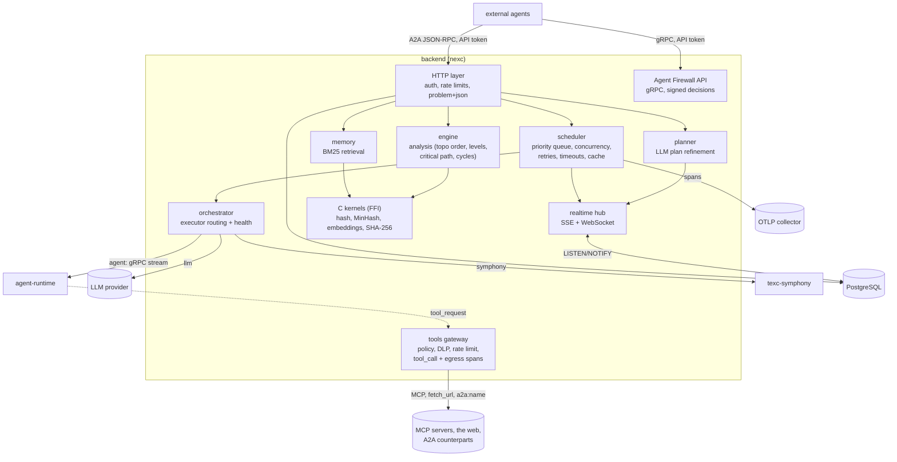
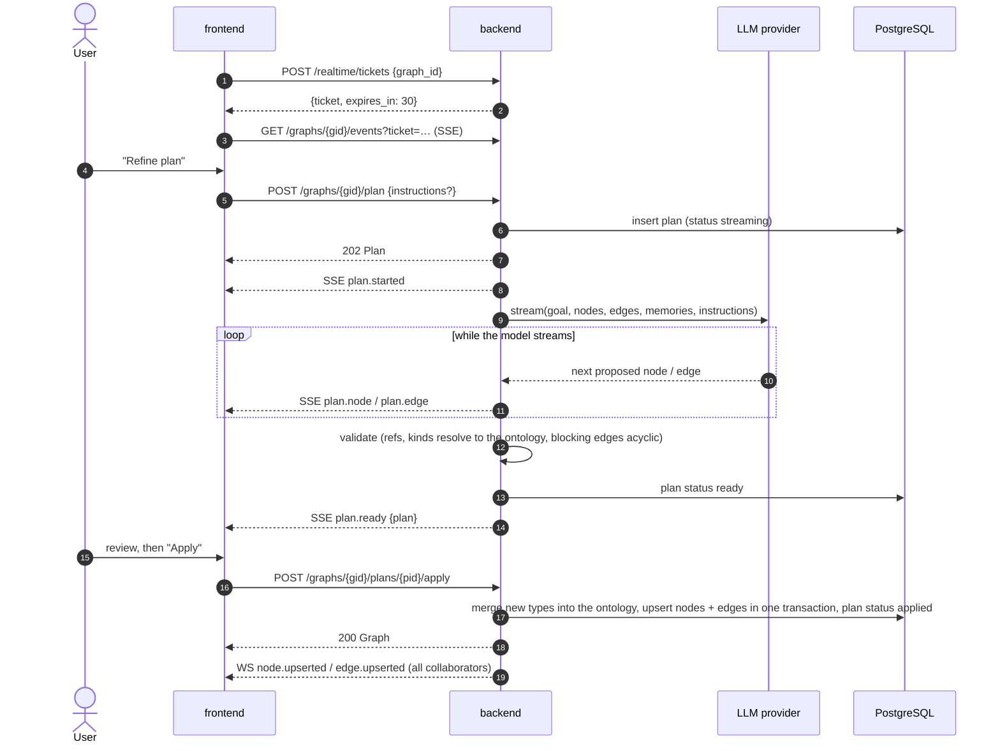
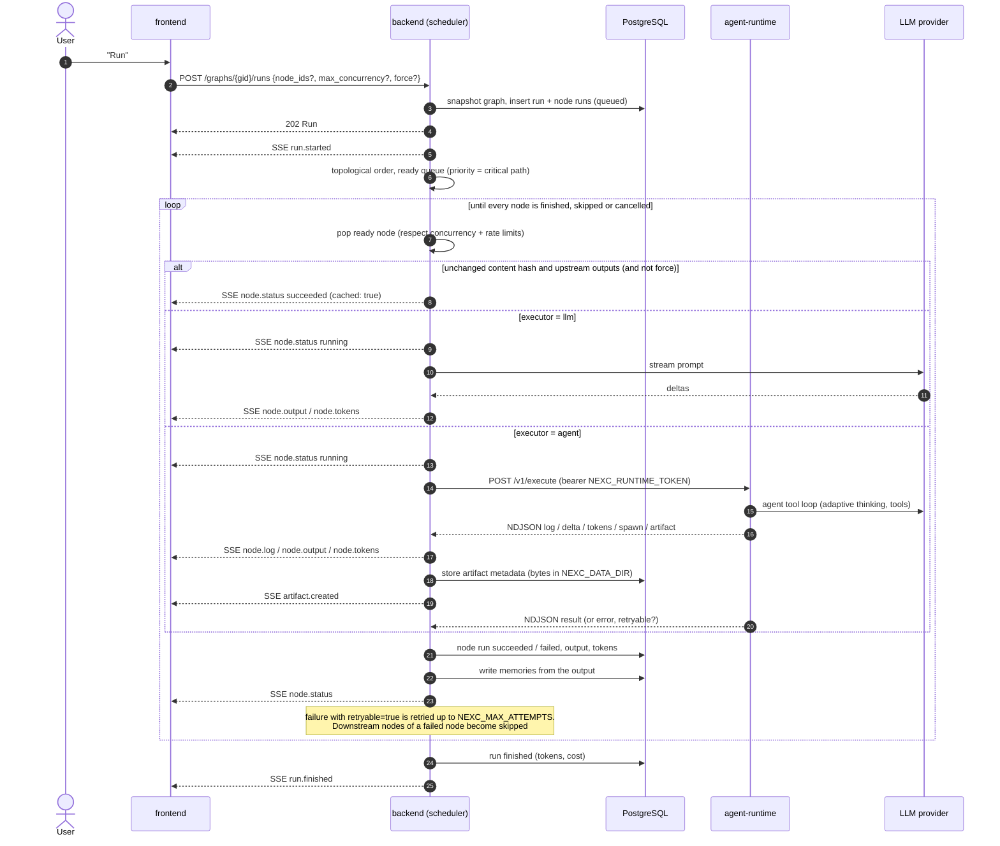
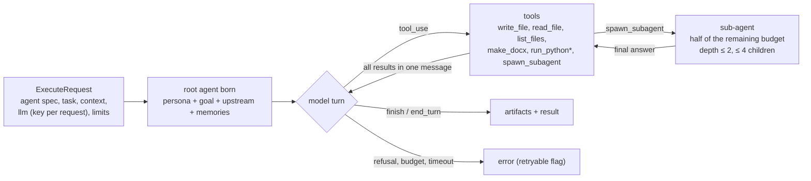

# Architecture

<!-- #region intro -->
This document explains how a request travels through nexc-engine. The wire-level contract
(types, endpoints, events, environment) is [CONTRACT.md](CONTRACT.md); when the two disagree, the
contract wins.

<!-- #endregion intro -->
<!-- #region components -->
## Components

| Component                    | Tech                                             | Responsibility                                                                                                                                                            |
| ---------------------------- | ------------------------------------------------ | ------------------------------------------------------------------------------------------------------------------------------------------------------------------------- |
| **frontend**                 | React 19, Vite, TypeScript, TanStack Query, zod  | Graph canvas, plan review, run monitoring, agents, memory, settings. Talks only to `/api/v1`.                                                                             |
| **backend** (`nexc serve`)   | Rust, axum, sqlx, utoipa                         | Auth, REST API, SSE + WebSocket hub, graph analysis, planner, scheduler, memory, orchestrator, artifact storage, the tools gateway, the Agent Firewall API (gRPC), the A2A adapter (agent cards and JSON-RPC at the root) and the OTLP export of the trace. |
| **agent-runtime**            | Python 3.12, FastAPI + grpclib, Anthropic SDK, python-docx | Executes `executor: agent` nodes: agents are born from a spec per request and run a tool loop in a sandboxed workspace.                                                   |
| **PostgreSQL 17**            |                                                  | Users, graphs, nodes, edges, plans, runs, artifacts metadata, agents, memories, refresh-token families. `LISTEN/NOTIFY` carries realtime events between backend replicas. |
| **texc-symphony** (optional) | Rust                                             | Executes `executor: symphony` nodes as Codex coding tasks.                                                                                                                |

<!-- #endregion components -->
<!-- #region auth -->
## Authentication in one paragraph

`POST /auth/login` returns a 15-minute JWT access token in the body and sets a rotating refresh
token in an `HttpOnly; SameSite=Strict` cookie scoped to `/api/v1/auth`. The SPA keeps the access
token in memory and refreshes with `POST /auth/refresh` (plus the `X-Requested-With: nexc` CSRF
header). Reusing an old refresh token revokes the whole token family. Realtime connections cannot
send headers, so the client first obtains a single-use, 30-second ticket from
`POST /realtime/tickets` and passes it as `?ticket=`.

Accounts are on one of two sides. A workspace-side account (`role: user`) works in its workspaces
and is refused on `/admin/*`. A platform administrator (`role: admin`) runs the installation from
the platform console and is refused on everything else: handlers take either `AuthUser` or
`PlatformAdmin` (`http/extract.rs`), and only the session endpoints take both. Each access token
carries the account's session epoch; suspending an account or changing its platform role raises
the epoch (`security/gate.rs`), so the tokens already issued stop working at once on this server
and within ten seconds on the others. Event streams and collaboration sockets note the epoch when
they open and close once it has risen.

<!-- #endregion auth -->
<!-- #region plan -->
## Flow 1: plan refinement

The user asks the LLM to turn a rough sketch into a concrete plan. The response is asynchronous:
the plan streams over SSE as it is generated, and nothing changes in the graph until the user
applies it.

If the model fails or produces an invalid plan the backend emits `plan.failed {plan_id, error}`
and the graph is untouched. In demo mode the planner is a deterministic offline generator.

<!-- #endregion plan -->
### The ontology

<!-- #region ontology -->
Nothing about node or relation types is compiled in. Every graph stores an **ontology**: its node
types (label, meaning, colour, default role and executor, stage, whether its nodes deliver a file or
may run code) and its relation types (label, meaning, and whether the relation is _blocking_). A
node's `kind` and an edge's `kind` are keys into it, and every edge carries a `reason`.

A new graph starts from a small starter ontology. The planner sees the current ontology, reuses its
types where they fit and proposes new node and relation types when the goal's domain needs them;
applying the plan merges them into the graph. Users edit the ontology in the canvas toolbar. The
engine reads behaviour from the types instead of from fixed names: blocking relations form the
execution DAG (other relations record meaning only and may point "backwards"), `stage` orders
suggested dependencies, `produces_artifact` routes deliverables, and each upstream output reaches
the next node together with the reason of the edge that carried it.

<!-- #endregion ontology -->
<!-- #region run -->
## Flow 2: running a graph

Running executes the DAG of blocking edges (`depends_on` in the starter ontology). Every node's prompt context is its own title and content,
the graph goal, the outputs of its upstream nodes and retrieved memories.

<!-- #endregion run -->
### The agent runtime protocol

<!-- #region runtime -->
The backend opens one gRPC stream per node attempt (`AgentRuntime/Execute`, the runtime's port
8095, `NEXC_RUNTIME_PROTOCOL=grpc`, the default): it sends the request as the first command and
reads the run's events; approval decisions, policy updates and the results of gateway calls go
down the same stream as commands, so nothing has to find the replica that holds a run. The
NDJSON endpoint is the same protocol as lines over HTTP and stays for one release
(`NEXC_RUNTIME_PROTOCOL=ndjson`). `POST /v1/execute` returns `application/x-ndjson`. The stream
always ends with exactly one `result` or `error` line; `error.retryable` tells the scheduler whether another attempt may help
(rate limits, 5xx and network errors) or not (refusals, invalid requests, exhausted budgets,
timeouts). `tokens` lines are per LLM call (incremental); `result` carries the run totals.
Artifacts are emitted after the agent finishes: every regular file in the run's workspace,
base64-encoded, with a sanitised relative path and a MIME type, at most 20 MiB each.

Inside the runtime:

<!-- #endregion runtime -->
### The tools gateway, the Agent Firewall API and the OTLP export

<!-- #region gateway -->
An agent never reaches the network: a tool that leaves the runtime (an MCP server registered
for the workspace, `fetch_url`) is a `tool_request` up the stream, and the backend performs it
after the policy decided the tool and the host, the DLP screen read the arguments and the
agent's rate limit let it through, under a timeout and a size cap, with a `tool_call` and an
`egress` span on the record. The Agent Firewall API (`NEXC_GRPC_ADDR`, off by default) offers
the same decisions and the same trace to agents that run elsewhere, over gRPC with a per-agent
API token: `AuthorizeAction` answers a signed decision, `ReportSpan` chains their spans into a
run of their own and re-decides each one, `VerifyTrace` recomputes the chain. With
`NEXC_OTLP_ENDPOINT` set, every span of the trace is also exported to an OpenTelemetry collector
(the run is the trace, the workspace the resource). `docs/CONTRACT.md` §8 has the wire.

The A2A adapter sits on the same parts (`docs/CONTRACT.md` §10, `docs/AGENTSECOPS.md` §11). An
agent an admin exposes publishes an agent card at `/.well-known/agent.json?agent=` and takes
JSON-RPC tasks at `/a2a/agents/{principal}` from registered counterparts, each of which is an
external agent principal of the workspace holding an API token. A task is a one-node run of
the agent in a managed graph of its own, claimed and executed by the instance that took it
(`scheduler::execute_claimed`) with the inbound call and the firewall's decision as the first
spans of its chain; its output and files come back as A2A artifacts. Agents call counterparts
as the gateway tool `a2a:<name>`, decided and recorded like any egress, with the hops and the
chain of principals carried in the task's metadata so the delegation depth and loops are
bounded across platforms. The surface lives at the root, where the protocol expects it; nginx,
the ingress and the Vite dev server proxy it to the backend as they do `/api`.

<!-- #endregion gateway -->
<!-- #region scaling -->
## Scaling and state

- **Backend** – stateless apart from `NEXC_DATA_DIR` (artifacts). Realtime events are published
  through PostgreSQL `LISTEN/NOTIFY`, so an SSE or WebSocket client receives events no matter which
  replica it is connected to, and you can run several replicas behind a load balancer. Scheduler:
  a queued run is claimed by the dispatcher of whichever replica looks first (`FOR UPDATE SKIP
  LOCKED`), usually the one that accepted its `POST /runs`, which wakes its own dispatcher. That
  replica holds a lease on the run (`NEXC_RUN_LEASE_SECS`) while the others relay its events. If
  it stops, the run is not lost: a crashed replica's lease runs out and another replica takes the
  run over with the next lease epoch, and a replica that shuts down hands its runs over at once.
  The new holder resumes from what was written (succeeded nodes keep their outputs, an
  interrupted node runs again with its next attempt, a node waiting for an approval waits on), and
  every write is fenced on the epoch, so a former holder that comes back writes nothing
  ([High availability](HA.md)). With more than one node, mount the artifact directory on shared
  (ReadWriteMany) storage.
- **Agent runtime** – fully stateless (per-run scratch directories are deleted after each run);
  scale freely. Each instance limits concurrent runs (`RUNTIME_MAX_CONCURRENT_RUNS`, default 8) and
  answers 429 (NDJSON) or `RESOURCE_EXHAUSTED` (gRPC) when full. The gRPC channel of a backend
  instance multiplexes its streams on one connection, so behind a plain ClusterIP Service it
  sticks to one pod: with several runtime replicas use a headless Service or a gRPC-aware proxy to
  spread the runs.
- **PostgreSQL** – the single source of truth; back it up together with `NEXC_MASTER_KEY`.

<!-- #endregion scaling -->
<!-- #region erase -->
## Deleting an account

Several tables cascade from an account's id (`graphs`, `agents`, `runs`, `plans`, `memories`), so
removing the row would delete work that belongs to a team. `engine::account::erase` therefore
empties the account instead: it removes the workspaces the account is alone in, its memberships,
personal settings, notifications, sessions and personal memories, clears its assignments, and
replaces its name and address (`users.deleted_at` marks the row). What it made in shared
workspaces keeps pointing at that row and reads as "Deleted account". Audit logs and the
platform's activity log keep every entry; the copies of the name and address in them are replaced
too, so the record of what happened stays and stops identifying the person. A name written into
free text (an issue's assignee history, a comment, a day summary) is not found and stays. The
same routine serves a person deleting their own account and a platform administrator erasing one
on request.

<!-- #endregion erase -->
<!-- #region worst -->
## Worst cases that are tested

`backend/tests/worst_case.rs` reads the routes from the OpenAPI document, so a route added later
is covered without being listed anywhere:

| Worst case                    | What the test does                                                                                                                                                                                                 |
| ----------------------------- | ------------------------------------------------------------------------------------------------------------------------------------------------------------------------------------------------------------------ |
| Someone without a session     | Every protected route is called with no token, a garbage token and a token signed with another key: 401 each time.                                                                                                 |
| A member of another workspace | Every `GET` that names a workspace, issue, graph, project or team is called with a victim's real ids: refused, or answered with nothing.                                                                           |
| Hostile input                 | Every route gets bodies of the wrong shape and type, injection strings, deep nesting, long strings and hostile query values (about 1,800 requests, the console's routes as a platform administrator): never a 5xx. |
| Races                         | Forty issues filed at once get forty consecutive numbers; two owners stepping down at once leave one; a refresh token or a reset link used several times at once works once.                                       |
| A large workspace             | With 20,000 issues and as many comments every list stays capped and answers within a budget; a 2 MiB body is refused; one account hammering the API gets 429 with `Retry-After` while others are served.           |
| A dependency that is down     | Without the agent runtime, uploads are accepted, plain text is still read, and the rest of the API answers.                                                                                                        |
| Several servers               | A session ended on one server stops working on another after its next look at the database.                                                                                                                        |
| A server dying mid-run        | `backend/tests/ha.rs`: two servers share a database; the one executing a run dies without a shutdown and the other takes the run over within the lease and 5 s and finishes it, every node succeeding once, the chain verified and no span missing; a former holder's late write is refused and recorded; a node waiting for an approval resumes after the takeover; a command the dead server never took is delivered by the new one; a server cut off from its lease stops by itself. |
| A reverse proxy               | The visitor's address is taken from the proxy's header only when `NEXC_TRUST_PROXY` is set.                                                                                                                        |

Not covered by a test: the database itself being down (`/readyz` reports it), disk full, and load
from many machines at once.

<!-- #endregion worst -->
<!-- #region boundaries -->
## Security boundaries

| Boundary               | Control                                                                                                                                                                                                                                                                    |
| ---------------------- | -------------------------------------------------------------------------------------------------------------------------------------------------------------------------------------------------------------------------------------------------------------------------- |
| Browser → backend      | JWT + refresh-cookie rotation, CSRF header on cookie endpoints, rate limits, 1 MiB body limit, problem+json errors without internals.                                                                                                                                      |
| Platform → workspaces  | A platform administrator's token is refused on every workspace route; the console reads counts and members, never content. Its actions (roles, suspensions, owners, deletions) are written to an activity log, and an owner it assigns also to that workspace's audit log. |
| Backend → runtime      | Shared bearer token (constant-time compare), internal network only, 4 MiB request limit, API keys passed per request and never stored or logged.                                                                                                                           |
| Agent → network        | The runtime makes no outbound call: MCP servers and `fetch_url` are the backend's gateway, which decides the tool and the host under the policy (private and loopback addresses refused unless named), screens the arguments for data leaving, limits calls per agent, times a call out, caps the answer, starts a stdio server with an empty environment in a scratch directory and records a `tool_call` and an `egress` span. |
| External agent → backend | The Agent Firewall API is off unless `NEXC_GRPC_ADDR` is set and is never for browsers; per-agent tokens are kept hashed and read on every call with the agent's status (a quarantine ends access at once); decisions are signed with Ed25519; reported spans are checked, bounded and re-decided like a runtime's. |
| A2A counterpart ↔ backend | An inbound task needs the API token of a registered counterpart (401, 403 as JSON-RPC errors; the agent's status read on every call); the exposed agent's counterpart list and delegation depth decide it before anything runs, loops are refused, and the task runs as an ordinary run under the agent's own policy. An outbound task is an egress of the gateway: the host under the egress rules, the labels against the counterpart's clearance, the DLP screen of the message, a timeout and a size cap, the remote's files screened as artifacts. The card is public only for exposed agents and names no secret. |
| Backend → collector    | The OTLP export (`NEXC_OTLP_ENDPOINT`, off by default) sends what the trace stores: digests, names, hosts, counts and decisions, never arguments, prompts or content. |
| Agent → filesystem     | Per-run workspace; `safe_path` rejects absolute paths, `..`, NUL/backslashes and symlink escapes; per-file and per-workspace quotas.                                                                                                                                       |
| Agent → code execution | Disabled by default. When enabled: `python -I`, scrubbed environment, rlimits (CPU, memory, file size, processes, open files), wall-clock timeout that kills the process group, truncated output.                                                                          |
| Untrusted model input  | Upstream outputs and memories are wrapped in tags and the system prompt marks them as data, not instructions.                                                                                                                                                              |
| Containers             | Non-root, read-only root filesystem, all capabilities dropped, `no-new-privileges`, seccomp `RuntimeDefault` on Kubernetes.                                                                                                                                                |

<!-- #endregion boundaries -->