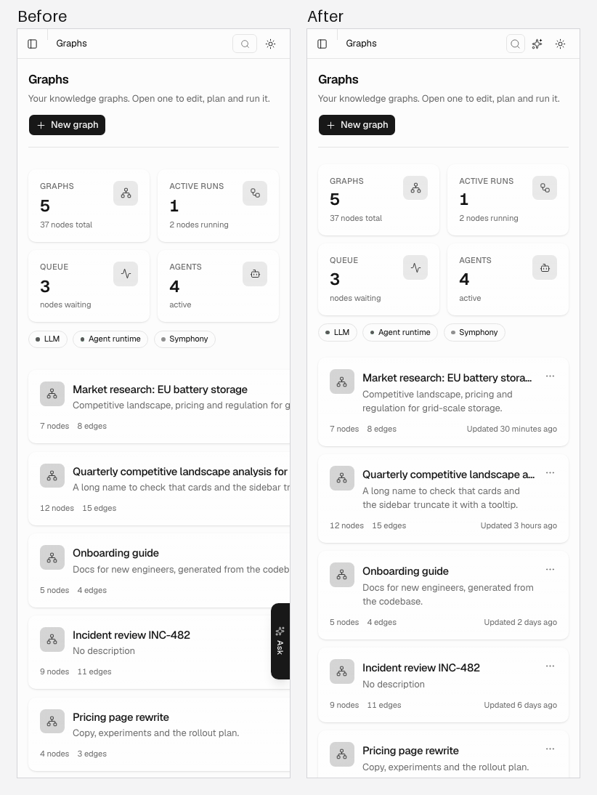
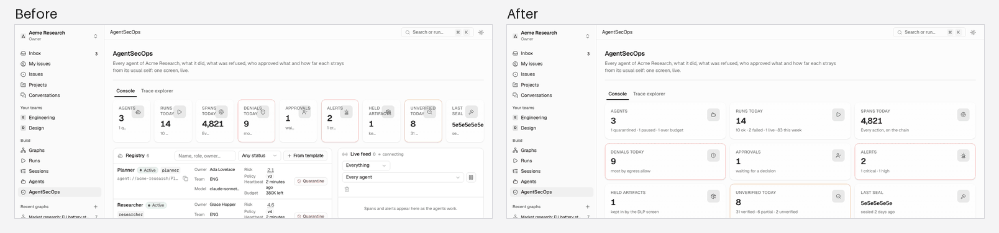
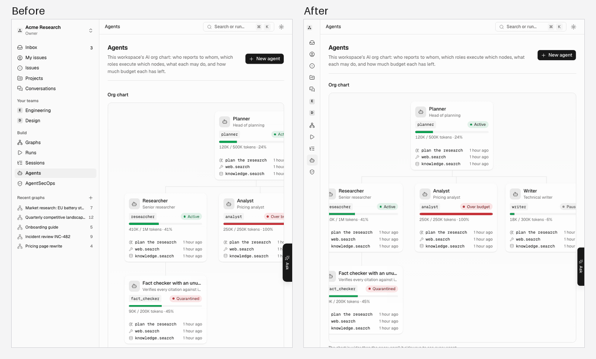
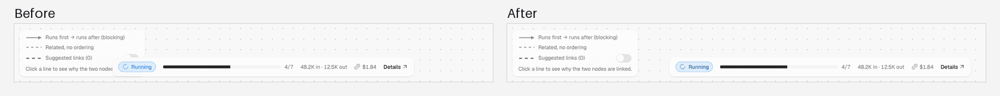
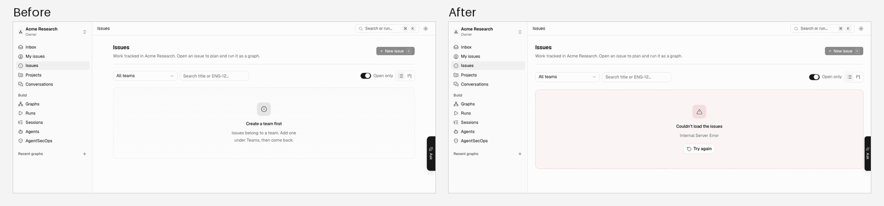

# UI audit

A quality pass over the SPA: every route of `src/app/router.tsx` (the login and register pages
aside, which belong to the auth flow) at 375, 768 and 1280 px, in light and dark, with a workspace
in use and with an empty one, plus each page while its data loads and when its requests fail.

## Method

The audit runs on the Playwright harness in this folder: the production build served by
`vite preview`, every `/api/v1` call answered from `fixtures/`, the browser signed in with a
mocked token, the clock fixed at 2026-10-14 12:00 UTC.

```sh
cd frontend
AUDIT_PHASE=before pnpm e2e:audit   # writes e2e/.audit/before/ (not committed)
AUDIT_PHASE=after pnpm e2e:audit    # the same on the fixed tree
```

For each route, width, theme and data set it saves a full-page screenshot
(`.audit/<phase>/shots/<data>/<theme>/<width>/<route>.png`) and a record of:

- **axe** (`@axe-core/playwright`, WCAG 2.2 A/AA and best practices);
- **the layout check**: `document.scrollingElement.scrollWidth <= innerWidth`, the same for the
  page's own scroller (`<main>`'s content), and no two visible interactive elements whose boxes
  intersect (nested controls and fixed overlays excepted);
- icon-only controls and whether anything names them on hover; text cut by an ellipsis or a line
  clamp that nothing reveals; the page's `h1` and where it sits; the empty states and whether they
  carry an icon, a sentence and an action;
- at 1280 px, light: controls whose focused look equals their resting look (30 tab stops; only
  what draws counts: an outline with a style and a colour, a shadow that is not transparent, the
  border, the background or an underline, on the control or its parent), the requests made on
  load, the polls over two minutes and the refetches on returning to the tab.

`loading` and `error` data sets (requests never answered, or answered 500) show the skeletons and
error states, recorded with axe at 375 and 1280 px. `summary.spec.ts` folds the records into `summary.json` and `states.json`. The
screenshots were then read page by page; the findings below combine both.

## In numbers

474 page states (41 routes × widths × themes × data sets) and 152 loading and error states, before
the fixes (`94111e3`) and after them, measured by the same audit. The before column was measured
again with the final checks, so a few figures differ from the first reading (the focus check was
made stricter, see F23).

| Check                                                      | Before                                                                                                                                    | After                                                                                               |
| ---------------------------------------------------------- | ----------------------------------------------------------------------------------------------------------------------------------------- | --------------------------------------------------------------------------------------------------- |
| axe serious or critical, page states                       | 153: `list` 60, `color-contrast` 39, `scrollable-region-focusable` 22, `target-size` 14, `aria-prohibited-attr` 12, `aria-command-name` 6 | 0                                                                                                   |
| axe moderate or minor, page states                         | 526: `region` 442, `page-has-heading-one` 48, `empty-table-header` 12, `landmark-unique` 12, `heading-order` 6, `landmark-one-main` 6     | 0                                                                                                   |
| axe serious or critical, loading and error states          | 34: `aria-prohibited-attr` 30 (labelled skeletons), `aria-command-name` 4 (the breadcrumb)                                                | 0                                                                                                   |
| axe moderate, loading and error states                     | 188: `region` 142, `page-has-heading-one` 42, `landmark-unique` 4                                                                         | 12: `page-has-heading-one` while a whole page is a skeleton (deferred, F31)                         |
| Horizontal scroll (layout check)                           | dashboard at 375 px (`<main>` +474 px)                                                                                                    | none                                                                                                |
| Intersecting controls (layout check)                       | dashboard at 768 and 1280 px (each graph card's link and its menu button)                                                                 | none                                                                                                |
| Loading placeholders that never resolve                    | graph, empty data (the breadcrumb); SecOps's risk panel when its overview fails                                                           | none                                                                                                |
| Icon-only controls with no tooltip                         | 83 controls on 25 routes                                                                                                                  | 0                                                                                                   |
| Text cut by an ellipsis that nothing reveals               | 61                                                                                                                                        | 0                                                                                                   |
| Controls whose focus does not show (30 tab stops a page)   | 6 on 4 routes                                                                                                                             | 0                                                                                                   |
| List pages whose empty state has no next step              | 11 of 24                                                                                                                                  | 1: the Activity page's selected day (deferred, F27)                                                 |
| Distinct page widths / title insets at 1280 px             | 7 widths; the title sits 23, 63, 123 or 183 px from the content edge                                                                      | 3 widths; 23 px on every app page, 63 px on every settings and platform page                        |
| Error states with **Try again** (76: 38 routes, 2 widths)  | 24                                                                                                                                        | 68: not the 404, Preferences (it loads nothing) or Profile (deferred, F30)                          |
| Error states with a level-one heading                      | 48 of 76                                                                                                                                  | 76 of 76                                                                                            |
| Requests refetched on returning to a tab after two minutes | 135 over the 41 routes, up to 10 on one page (Agents)                                                                                     | 47, at most 4 on one page (a run)                                                                   |
| Polls over two minutes                                     | the orchestrator status on 33 routes                                                                                                      | the orchestrator status on the dashboard only; otherwise a page's own live data and the inbox count |

## Findings

Severity: **high** breaks a task or hides content; **medium** degrades it or fails WCAG AA;
**low** is polish. Status: **fixed**, or **deferred** with the reason under "After".

### Layout and responsiveness

| ID  | Sev.   | Finding                                                                                                                                                                                                                                                                                                                                                                                | Where                                                                                                                                    | Status |
| --- | ------ | -------------------------------------------------------------------------------------------------------------------------------------------------------------------------------------------------------------------------------------------------------------------------------------------------------------------------------------------------------------------------------------- | ---------------------------------------------------------------------------------------------------------------------------------------- | ------ |
| F01 | high   | The graph card grid is 474 px wider than a phone: card text, the actions menu and the "Updated" date are cut off and the page scrolls sideways (grid items keep their min-content width because the one-column grid has no `minmax(0, 1fr)` track).                                                                                                                                    | dashboard 375, light and dark                                                                                                            | fixed  |
| F02 | high   | The nine AgentSecOps tiles go into one row at the `xl` breakpoint, but the content beside the sidebar is ~1000 px: each tile is ~100 px, the labels run under the icons ("AGENTS", "APPROVALS", "HELD ARTIFACTS") and the hints are cut to "1 q…", "10 …". At 375 px the hints are cut too, with no way to read them.                                                                  | secops 1280, 375                                                                                                                         | fixed  |
| F03 | high   | At 768 px the permanent 240 px sidebar leaves 528 px for the page: graph card metadata breaks over two lines, the org chart and the agents table are cut, and most tables scroll sideways.                                                                                                                                                                                             | every app, settings and platform page at 768                                                                                             | fixed  |
| F04 | high   | The assistant notch is fixed to the right edge and covers the right 28–32 px of every page: status badges and the last table column, card menus, issue avatars, inbox timestamps; at 1280 px it sits on the org chart and the SecOps alerts.                                                                                                                                           | every app page, worst at 375 and 768                                                                                                     | fixed  |
| F05 | high   | On the canvas the legend (bottom left) and the run progress bar (bottom) overlap at every width: the "Suggested links" switch and the legend's hint sit under the progress panel.                                                                                                                                                                                                      | graph 375, 768, 1280                                                                                                                     | fixed  |
| F06 | medium | The session tree column is too narrow for what each row carries: titles are cut to a few characters ("Define the r…", the root row to "R…").                                                                                                                                                                                                                                           | session 1280                                                                                                                             | fixed  |
| F07 | medium | Tables on phones keep every column, so the ones that matter are off-screen: Runs (status cut; tokens, cost, duration unreachable), Sessions (agents), Members (the role select and the remove button), Agents (role onward), Run detail (node runs), Usage, Infrastructure (latency). Their scroll regions cannot be reached by keyboard (axe `scrollable-region-focusable`, serious). | runs, sessions, settings-members, agents, run-detail, settings-usage, platform-infrastructure, settings-policies, secops, session at 375 | fixed  |
| F08 | medium | Platform workspaces on a phone show their counts without the column labels ("3 12 5").                                                                                                                                                                                                                                                                                                 | platform-workspaces 375                                                                                                                  | fixed  |
| F09 | medium | The org chart opens scrolled to its left edge: at 375 and 768 px the root agent is off-screen; at 1280 px the second root is cut with nothing showing that the chart scrolls.                                                                                                                                                                                                          | agents                                                                                                                                   | fixed  |
| F10 | medium | Approve and Deny squeeze an approval's text into a ~120 px column on a phone.                                                                                                                                                                                                                                                                                                          | inbox 375                                                                                                                                | fixed  |
| F11 | low    | Issue rows on a phone leave ~60 px for the title next to priority, identifier, state, sub-issues, graph, due date and avatar ("Collect …").                                                                                                                                                                                                                                            | issues, my-issues, project 375                                                                                                           | fixed  |
| F12 | low    | The SecOps alerts list gives the severity and kind badges a column of their own: titles wrap into a narrow column and the last alert is clipped by the panel's fixed height.                                                                                                                                                                                                           | secops 1280, 375                                                                                                                         | fixed  |
| F13 | low    | Platform accounts on a phone: the role select, badges and the actions menu wrap onto separate rows with uneven gaps.                                                                                                                                                                                                                                                                   | platform-users 375                                                                                                                       | fixed  |

### Page structure and headers

| ID  | Sev.   | Finding                                                                                                                                                                                                                                                                                                            | Where                                                                                   | Status |
| --- | ------ | ------------------------------------------------------------------------------------------------------------------------------------------------------------------------------------------------------------------------------------------------------------------------------------------------------------------ | --------------------------------------------------------------------------------------- | ------ |
| F14 | medium | Page titles jump from page to page: containers use seven widths (`max-w-3xl` to `96rem`) and four vertical rhythms, so at 1280 px the title sits 23 px (Graphs, Agents), 63 px (Issues, Projects), 123 px (Inbox) or 183 px (Conversations) from the content edge; settings pages jump between 63, 123 and 183 px. | all                                                                                     | fixed  |
| F15 | medium | No `h1` on the canvas, the project page, the 404 pages and the route error state (axe `page-has-heading-one`); the signed-out 404 page has no `main` landmark.                                                                                                                                                     | graph, project, app-not-found, not-found, every route error                             | fixed  |
| F16 | low    | Graph card titles are `h3` directly under the page's `h1` (axe `heading-order`).                                                                                                                                                                                                                                   | dashboard                                                                               | fixed  |
| F17 | low    | Primary actions are placed three ways: in the page header (New graph, New agent, New issue), in the body under a sentence (Register a counterpart, Add a destination, Register a server), or in the filter bar (New issue on My issues).                                                                           | settings-a2a-counterparts, settings-alert-destinations, settings-mcp-servers, my-issues | fixed  |

### Controls and accessibility

| ID  | Sev.   | Finding                                                                                                                                                                                                                                                                                                                                                | Where                                                                                       | Status |
| --- | ------ | ------------------------------------------------------------------------------------------------------------------------------------------------------------------------------------------------------------------------------------------------------------------------------------------------------------------------------------------------------ | ------------------------------------------------------------------------------------------- | ------ |
| F18 | high   | Icon-only controls with an accessible name but nothing a sighted reader can see: delete and remove buttons in settings lists, copy, download, fold and unfold in the session tree, pause and clear on the live feed, list and board view, the agents table's actions, the header's search button on a phone. A few use a native `title`, most nothing. | 25 routes                                                                                   | fixed  |
| F19 | medium | Text below 4.5:1 in light mode: status badges (Running, Failed, Succeeded, Cancelled, Queued) and evidence chips draw 12 px text in the raw status colour on a 12 % tint; destructive badges (Suspended, not answering, card not read), severity badges and the session's Stop label likewise (axe `color-contrast`, serious).                         | 13 routes, light                                                                            | fixed  |
| F20 | medium | The sidebar's recent graphs list puts a `<p>` straight inside its `<ul>` when there are none (axe `list`, serious).                                                                                                                                                                                                                                    | every app page, empty data, 768 and 1280                                                    | fixed  |
| F21 | medium | `aria-label` on elements without a role: the inbox's unread dot, the activity page's summary box (axe `aria-prohibited-attr`, serious) and the sidebar's unread badge.                                                                                                                                                                                 | inbox, settings-activity, every app page                                                    | fixed  |
| F22 | medium | Targets under 24 × 24 px: the activity page's day bars (8 px wide), the session tree's fold and stop buttons, the alerts page's run links (axe `target-size`, serious).                                                                                                                                                                                | settings-activity, session, settings-alerts                                                 | fixed  |
| F23 | medium | Focus not visible: conversation rows, the policy version list, the project name field, platform workspace rows, the org chart's agent cards (long names), a SecOps tile with `tabindex`.                                                                                                                                                               | conversations, settings-policies, project, platform-workspaces, agents, secops              | fixed  |
| F24 | low    | Landmarks: the sidebar navigation is not a `nav`, so its links and the assistant notch sit outside any landmark (axe `region`, every page); SecOps has two regions named alike (`landmark-unique`); the members table has an empty header cell (`empty-table-header`).                                                                                 | all                                                                                         | fixed  |
| F25 | low    | Text cut with an ellipsis that nothing reveals: graph names on cards, agent names and span names on the org chart, issue titles, document names, memory content, stat tile hints, the session tree's details.                                                                                                                                          | dashboard, agents, issues, settings-knowledge, settings-memory, secops, run-detail, session | fixed  |
| F26 | low    | While the graph is missing, the breadcrumb renders an empty link (axe `aria-command-name`, serious) with a skeleton that never resolves.                                                                                                                                                                                                               | graph, empty data                                                                           | fixed  |

### Empty, loading and error states

| ID  | Sev.   | Finding                                                                                                                                                                                                                                                                                                                       | Where                                                                                 | Status                                          |
| --- | ------ | ----------------------------------------------------------------------------------------------------------------------------------------------------------------------------------------------------------------------------------------------------------------------------------------------------------------------------- | ------------------------------------------------------------------------------------- | ----------------------------------------------- |
| F27 | medium | Empty states that stop at a sentence: Issues and My issues ("Create a team first", no link to Teams), Inbox, Projects (the form is above, nothing points at it), Sessions, Knowledge, Memory, Alerts, Audit log, the missing project and session.                                                                             | 11 list pages                                                                         | fixed; Activity day deferred                    |
| F28 | medium | No empty state at all: Usage shows four empty tables reading "Nothing in this period.", the workspace map shows two headings with nothing under them, Platform activity a bare line in a box, the SecOps panels bare lines.                                                                                                   | settings-usage, settings-map, platform-activity, secops                               | fixed                                           |
| F29 | high   | A failed request is shown as an empty state: when teams, sessions, documents or memories cannot be loaded, Issues says "Create a team first", Sessions "No sessions", Knowledge "No documents yet", Memory "No memories yet", the project page "No such project". The reader is sent to create something that may well exist. | issues, my-issues, sessions, settings-knowledge, settings-memory, project, error data | fixed                                           |
| F30 | medium | Error states three ways: pages that suspend fall back to the route error (the header and its title gone, no `h1`); list pages print the server's title in red ("Internal Server Error") with no retry; Profile and Data transfer show nothing at all.                                                                         | all, error data                                                                       | fixed in part; see Deferred                     |
| F31 | low    | Loading states: most pages show a skeleton shaped like the page; the canvas shows a skeleton plus a spinner and "Loading…", and the assistant panel a sentence.                                                                                                                                                               | graph, assistant                                                                      | fixed in part; canvas and loading `h1` deferred |

### Caching

| ID  | Sev.   | Finding                                                                                                                                                                                                                                                                                                                            | Where         | Status |
| --- | ------ | ---------------------------------------------------------------------------------------------------------------------------------------------------------------------------------------------------------------------------------------------------------------------------------------------------------------------------------- | ------------- | ------ |
| F32 | medium | Refetch storm on focus: every query is stale after 30 s, so coming back to a tab refetches everything on the page: 10 requests on Agents (one activity request per agent), 8 on Runs (one per graph), 7 on SecOps, and the workspaces, teams and sidebar graphs on every page, although members, teams and settings change rarely. | all           | fixed  |
| F33 | low    | The orchestrator status is polled every 15 s on every app page: the demo banner and the dashboard share one query whose options carry the interval.                                                                                                                                                                                | all app pages | fixed  |

## After

The audit run again on the fixed tree (`AUDIT_PHASE=after`), with the numbers above. Since then
the UI suite holds every route to most of it in CI (`ui.spec.ts`, `make e2e-ui`): no sideways
scroll, no overlapping controls, no serious or critical axe violation in any page, skeleton or
error state, and screenshot baselines of ten main pages at 375, 768 and 1280 px.

### The five worst, before and after

**F01, the graph cards on a phone.** The one-column grid kept each card at its content's width,
474 px past the screen; the grid's track and the motion wrapper now shrink to it
(`minmax(0, 1fr)`, `min-w-0`), the description wraps, and the menu and "Updated" are back.



**F02, the AgentSecOps tiles.** Nine tiles in one row at `xl` left each ~100 px. The grid now
follows the console's own width (a container query): two to a row on a phone, three until there
is room for nine, and a tile wraps its label and hint instead of cutting them.



**F03, the sidebar on a tablet.** From 768 to 1023 px the sidebar is a rail of icons named by
tooltips, which gives the page 720 px instead of 528; the org chart opens centred on its root and
says that it scrolls.



**F05, the canvas legend and the run's progress.** Both were pinned to the bottom of the canvas
and overlapped; they now share one bottom bar: side by side from 1024 px, the legend above the
progress on a tablet, and on a phone the progress alone.



**F29, a failed request shown as an empty state.** With every request failing, Issues said
"Create a team first"; it now says it could not load the issues, why, and offers **Try again**.
Sessions, Knowledge, Memory, the project page and Policies do the same.



### Deferred

- **F27, the Activity page's selected day.** "Nothing happened that day" has no action: a quiet
  day has nothing to create, and the busy days are one click away on the chart above it.
- **F30, pages that load everything before drawing.** Twelve pages (Graphs, Runs, a run,
  Agents, Conversations, Projects, the canvas, Members, Teams, AI accounts, Guardrails, Usage)
  read their data before they render, so a failed load still replaces the page, header and all,
  with the route's error. That error is now the same `ErrorState` as everywhere else, with a
  level-one heading, **Try again** and **Go to dashboard**, and the breadcrumb still names the
  page; keeping the header would mean splitting each page's data from its frame, a change per
  page for a state a reader rarely sees.
- **F30, Profile.** Its account cards keep their own handling: the sessions and two-factor cards
  show nothing of their own while they load or when they fail, and the security activity prints
  a failed load in red. These cards belong to the sign-in and account flow, which is being
  changed for single sign-on at the same time; they are left to that work.
- **F31, the canvas while the graph loads.** The canvas keeps its spinner on the dotted ground:
  until the graph is known there is no layout to sketch. Six pages that replace their whole body
  with a skeleton (Graphs, Runs, a run, Agents, the canvas, a project) have no `h1` for that
  moment (axe `page-has-heading-one`, moderate); their header arrives with their data.

### Notes

- **F23** was first written from a version of the focus check that read the styles before the
  focus transition had settled. Measured with the final check (settled, and counting only what
  draws), the pre-fix tree hides focus on 6 controls: the conversation rows, the policy
  versions, the project's name field and a SecOps tile. The platform workspace rows and the org
  chart's cards named in F23 do show focus.
- The after audit and the suite's loading and error checks found three more things, all fixed: labelled skeletons that
  were plain `div`s (`aria-prohibited-attr`), the SecOps risk panel that kept its skeleton when
  the overview failed, and Infrastructure, Policies, an agent's approvals and alerts and a
  destination's deliveries, which still printed a failed load in red with no way to retry.
- The baselines are rendered in the Playwright image for `linux/amd64` that CI runs; on an arm64
  machine `make e2e-ui` emulates it, which is slower but compares pixel for pixel.
